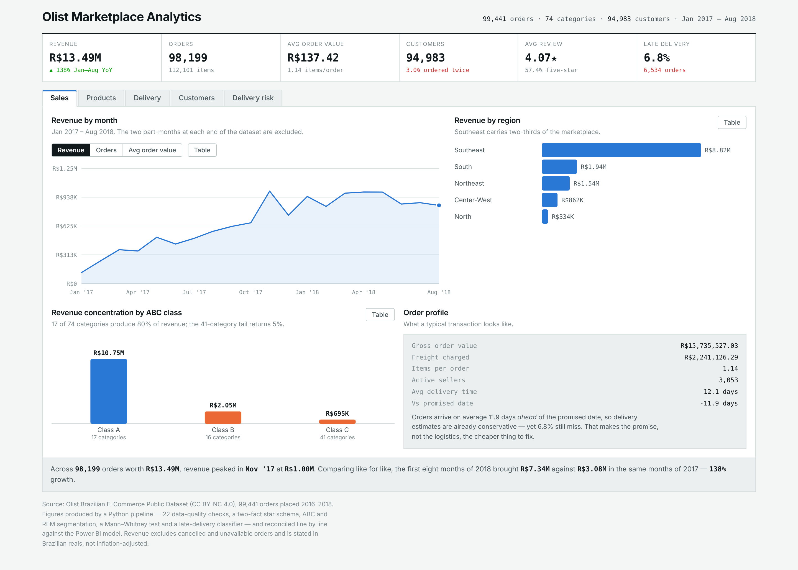
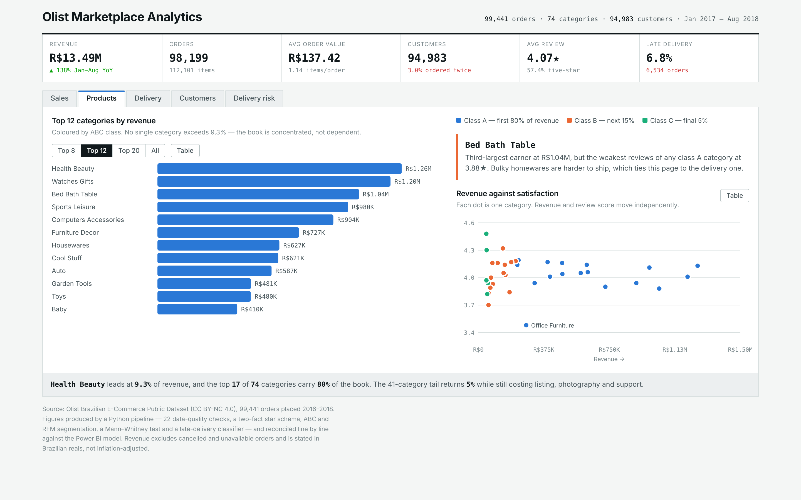
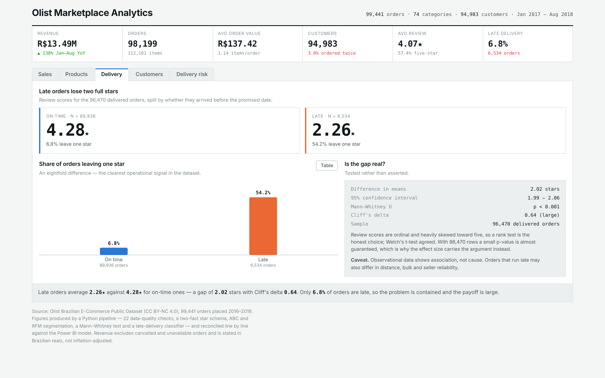
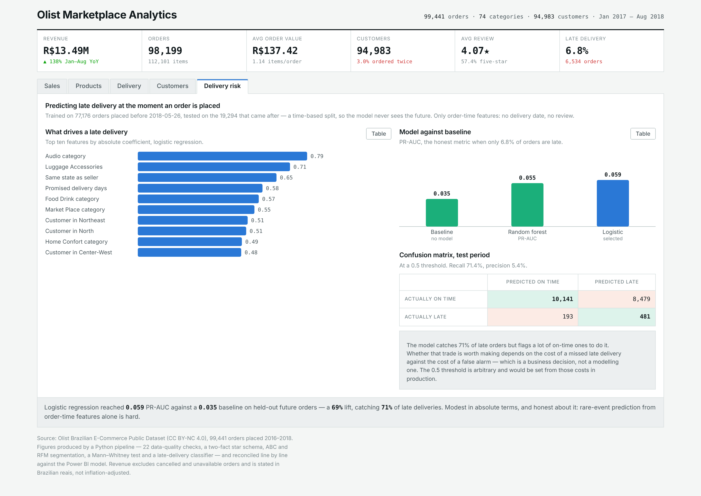

# Olist E-Commerce Analytics: Pipeline + Power BI Dashboard

End-to-end analysis of **99,441 orders** from Olist, a Brazilian online marketplace: a
tested Python pipeline that validates, models and analyses the data, plus two front ends
built on its output — a Power BI report and an interactive web dashboard.

### [Open the live dashboard](https://vipparlapranay.github.io/olist-sales-bi/)

Five views — sales, product concentration, the delivery–satisfaction gap, customer
segments and the late-delivery risk model. Switch metric, change the top-N, flip any
chart to the table behind it. No install, no download.



## Headline findings

- **Revenue is concentrated, not dependent.** 17 of 74 categories generate 80% of
  revenue, but no single category exceeds 9.3%. The 41-category tail returns about 5%
  while still costing listing, photography and support.
- **Late delivery costs two full stars.** Late orders average 2.26 against 4.28 for
  on-time ones, and 54.2% of late orders leave one star against 6.8% of on-time orders.
  Mann–Whitney U, p < 0.001, Cliff's delta 0.64 — a large effect, tested rather than
  asserted.
- **Only 3% of customers ever order twice.** Of 94,983 unique customers, 2,887 came
  back. Every sale depends on paid acquisition.
- **Growth is real but easy to misread.** The data stops in August 2018, so a calendar
  comparison puts twelve months against eight. Like for like, the first eight months of
  2018 brought R$7.34M against R$3.08M in the same months of 2017 — 138% growth.

Full write-up: [docs/analysis_report.md](docs/analysis_report.md)

## The questions this answers

1. How is revenue trending, and are we growing year on year?
2. Which categories drive most revenue, and which underperform?
3. Where are our customers, and which regions contribute most?
4. Does late delivery hurt customer satisfaction, and by how much?
5. Which orders are likely to be delivered late?

## What I built

**A Python pipeline** (`src/olist/`) with four stages, run from a CLI:

| Stage | What it does |
|---|---|
| `validate` | 22 data quality checks (keys, foreign keys, nulls, allowed values, chronology), scored out of 100 |
| `build` | Star schema with two fact tables, written as CSV for Power BI |
| `analyse` | ABC classification, RFM segmentation, delivery/satisfaction significance test |
| `ml` | Late-delivery risk model, scoring every order |

**A Power BI report** — a single dynamic page built on field parameters, bookmark
navigation between five analytical views, and a slide-out filter panel. Switching views
doesn't reset the user's filters, because the bookmarks capture display state only.
Build notes: [docs/09_single_page_dashboard.md](docs/09_single_page_dashboard.md)

**A web dashboard** ([live](https://vipparlapranay.github.io/olist-sales-bi/),
source in `docs/index.html`) — the same model as a self-contained page, for anyone who
would rather click a link than download a `.pbix`.

**60 DAX measures** covering revenue, time intelligence, dynamic ranking, Pareto
analysis, delivery performance, review satisfaction, RFM segments and model risk bands.

**18 unit tests** on the transform and validation logic, running in GitHub Actions.

## Data model

A star schema with **two fact tables at their natural grain**, sharing conformed
dimensions:

- `fact_sales` — one row per order item, for revenue, product and seller analysis
- `fact_orders` — one row per order, for delivery, payment and review metrics

Revenue is measured per item; delivery time and review score are measured per order.
Combining them in one table would count an order's delivery time once per item and
inflate every average. Facts connect only through shared dimensions, never to each other.

Two analytical outputs join in as dimensions: `dim_category_abc` (A/B/C class per
category) and `dim_customer_segment` (RFM scores), plus `fact_order_risk` carrying the
model's predicted late-delivery probability per order.

Details: [docs/03_data_model.md](docs/03_data_model.md)

## Verification

Every headline KPI is calculated **twice** — once in pandas, once in DAX — and
reconciled line by line. Two independent implementations agreeing is evidence; one
agreeing with itself is not.

| KPI | Python | Power BI |
|---|---|---|
| Revenue | 13,494,400.74 | 13.49M |
| Orders | 98,199 | 98K |
| AOV | 137.42 | 137.42 |
| Avg Review Score | 4.07 | 4.07 |
| Late Delivery % | 6.8% | 6.77% |

Full table: [docs/reconciliation.md](docs/reconciliation.md)

## The views

**Products** — the top categories by revenue, coloured by ABC class, with revenue
plotted against review score to show the two move independently. Bed Bath Table is the
third-largest earner and the weakest-reviewed class A category, which is what connects
this view to the delivery one.



**Delivery** — the review gap, as rates rather than counts. On-time orders outnumber
late ones roughly fourteen to one, so a raw count chart shows a taller on-time bar at
every score and contradicts the finding; the claim is about rates, so the chart plots
rates. The significance test sits beside it, with the causation caveat stated.



**Delivery risk** — the classifier against its baseline, the ten strongest features, and
a confusion matrix with the precision/recall trade-off named rather than hidden.



There is also a **Customers** view covering the RFM segments
([screenshot](screenshots/04_customers.png)).

## Data quality issues handled

- `customer_id` regenerates per order, so real customers are counted by `customer_unique_id`
- Reviews reduced to the latest per order (some orders were reviewed twice)
- Multiple payment rows per order aggregated before modelling, to avoid duplicating revenue
- Misspelled source columns renamed; zip prefixes kept as text to preserve leading zeros
- Missing category translations fall back to the Portuguese name, then "Unknown"
- `dim_date` spans whole calendar years so time intelligence has no gaps, which means
  trend visuals need an explicit Jan 2017 – Aug 2018 filter or they plunge to zero at
  both ends
- Cancelled and unavailable orders excluded from revenue throughout

Full report: [docs/data_quality_report.md](docs/data_quality_report.md)

## Late-delivery risk model

A classification model predicting whether an order will arrive after its promised date,
using **only features available at order time** — no delivery dates, no review scores, as
including those would be target leakage.

Trained with a **time-based split** (earliest 80% train, most recent 20% test), because a
random split lets the model see the future and inflates the score. Logistic regression
was compared against random forest and selected on PR-AUC, the honest metric when only
6.8% of orders are late.

It reaches 0.059 PR-AUC against a 0.035 baseline — a 69% lift, catching 71% of late
deliveries at 5.4% precision. Modest in absolute terms, and the report says so: rare-event
prediction from order-time features alone is hard, and the threshold is a business
decision about the cost of a false alarm, not a modelling one.

Results and limitations: [docs/ml_report.md](docs/ml_report.md)

## Tools

Python (pandas, NumPy, scikit-learn, SciPy, matplotlib), pytest, Power BI Desktop, DAX,
Power Query (M), Git/GitHub Actions

## How to run

```bash
# 1. Set up
python -m venv .venv
.\.venv\Scripts\Activate.ps1      # Windows
pip install -r requirements.txt

# 2. Add the data
# Download "Brazilian E-Commerce Public Dataset by Olist" from Kaggle
# and unzip the 9 CSVs into data/

# 3. Run the pipeline
python -m olist.pipeline all

# 4. Run the tests
pytest
```

The pipeline writes model tables to `outputs/model/`, charts to `outputs/figures/`, and
four markdown reports to `docs/`. The Power BI report reads the CSVs in `outputs/model/`;
see [docs/08_powerbi_connect.md](docs/08_powerbi_connect.md).

Load the CSVs without renaming the queries — the DAX in `dax/01_measures.dax` uses the
pipeline's own lowercase table and column names (`fact_orders[is_late]`,
`dim_date[date]`), so the names line up as they load.

The `.pbix` file is excluded from the repository for size.

## Next steps

- Row-level security by region, then dynamic RLS with `USERPRINCIPALNAME()`
- Seller performance view: late rate and review score by seller
- Investigate whether late delivery causes low reviews, or whether both stem from
  distance and product type — current findings show association, not causation

## Data source

Olist, *Brazilian E-Commerce Public Dataset*, via Kaggle (CC BY-NC 4.0). Raw data isn't
included in this repository; see the Kaggle page for licence terms.
