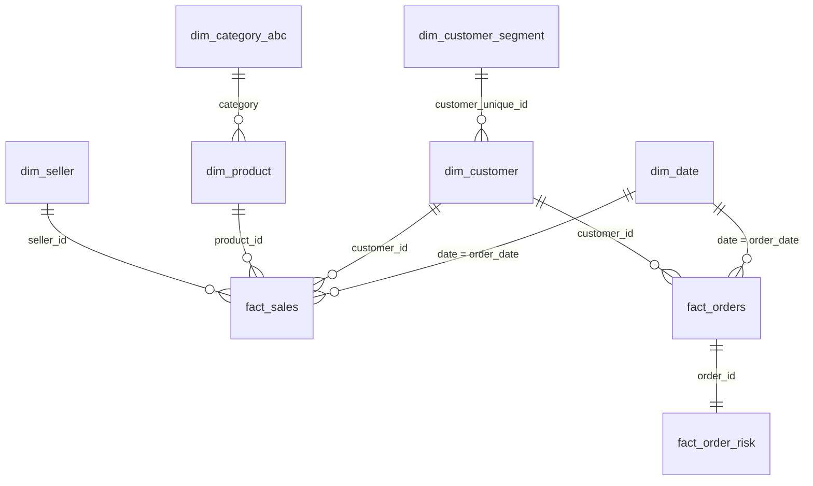

# Data model

## Why two fact tables, not one

The obvious design is a single fact table at item level. It breaks on the first delivery
question: **delivery and review data belong to the order, but revenue belongs to the
item.** Put delivery days on an item-grain table and an order with three items counts
three times in "average delivery days". Put revenue on an order-grain table and product
and seller detail disappears.

The fix is two fact tables, each at its natural grain, sharing the same dimensions — a
fact constellation.

| Table | Grain | Used for |
|---|---|---|
| `fact_sales` | one row per order item | revenue, items, categories, sellers |
| `fact_orders` | one row per order | delivery performance, reviews, payments |

Two order-level fields (`review_score`, `is_late`) are deliberately copied onto
`fact_sales` so category-level questions like "which categories get the worst reviews?"
can be answered without crossing facts. That is controlled denormalisation: fine for
slicing, wrong for averaging delivery time.

## Naming

Tables and columns are lowercase snake_case throughout, exactly as the pipeline writes
them to `outputs/model/`. Load the CSVs into Power BI without renaming the queries and
every measure in `dax/01_measures.dax` resolves as written.

## Diagram

## Tables and columns

**`fact_sales`** (order items joined to order-level flags)
order_id, order_item_id, product_id, seller_id, customer_id, order_date, order_status,
price, freight_value, line_total, is_valid_sale, is_late, is_delivered, review_score

**`fact_orders`** (orders + aggregated payments + latest review)
order_id, customer_id, order_date, order_status, order timestamps, payment_value,
max_installments, payment_lines, main_payment_type, review_score, review_count,
is_delivered, delivery_days, promised_days, days_vs_estimate, is_late, is_valid_order

**`dim_customer`**: customer_id (key), customer_unique_id, customer_city_name,
customer_state_code, customer_state_name, customer_region, customer_zip_code_prefix

**`dim_product`**: product_id (key), product_category_name, category (English, tidied),
product_name_length, product_description_length, product_photos_qty, weight and size

**`dim_seller`**: seller_id (key), seller_city_name, seller_state_code,
seller_state_name, seller_region

**`dim_date`**: built by the pipeline (`build_dim_date` in `src/olist/transform.py`) and
written to `dim_date.csv` — date, year, quarter, month_no, month, year_month,
year_month_sort, weekday_no, weekday, is_weekend.

It spans **whole calendar years**, Jan 1 to Dec 31, not the min and max of the data.
Time intelligence needs a continuous calendar with no holes, so building it from the
data's range would leave gaps that break `SAMEPERIODLASTYEAR`. The cost is trailing
months with no sales, which is why every trend visual carries an explicit
Jan 2017 – Aug 2018 filter.

## Analytical outputs that join as tables

These come out of the `analyse` and `ml` stages, not the source data:

| Table | Grain | Joins on | Carries |
|---|---|---|---|
| `dim_category_abc` | one row per category | `category` | revenue, revenue_share, cumulative_share, avg_review, abc_class |
| `dim_customer_segment` | one row per real customer | `customer_unique_id` | recency_days, frequency, monetary, r/f/m scores, segment |
| `fact_order_risk` | one row per delivered order | `order_id` | late_risk, risk_band, is_late_actual |

## Relationships

| From (one) | To (many) | Cardinality | Cross-filter |
|---|---|---|---|
| `dim_date[date]` | `fact_sales[order_date]` | 1 : * | Single |
| `dim_date[date]` | `fact_orders[order_date]` | 1 : * | Single |
| `dim_customer[customer_id]` | `fact_sales[customer_id]` | 1 : * | Single |
| `dim_customer[customer_id]` | `fact_orders[customer_id]` | 1 : * | Single |
| `dim_product[product_id]` | `fact_sales[product_id]` | 1 : * | Single |
| `dim_seller[seller_id]` | `fact_sales[seller_id]` | 1 : * | Single |
| `dim_category_abc[category]` | `dim_product[category]` | 1 : * | Single |
| `dim_customer_segment[customer_unique_id]` | `dim_customer[customer_unique_id]` | 1 : * | Single |
| `fact_orders[order_id]` | `fact_order_risk[order_id]` | 1 : 1 | Single |

Do **not** relate `fact_sales` to `fact_orders` directly, and delete any such
relationship Power BI's autodetect creates on import. Facts talk to each other only
through shared dimensions; a direct fact-to-fact link creates an ambiguous filter path
and silently deactivates one of the dimension relationships instead.

After loading, check Model view for exactly this: autodetect tends to invent
`fact_sales` ↔ `fact_order_risk` and `fact_sales` ↔ `fact_orders`, which deactivates
`fact_sales` → `dim_customer`.

## Tidy-up checklist

- [ ] Mark `dim_date` as a date table (Table tools → Mark as date table → `date`)
- [ ] Delete any fact-to-fact relationship autodetect created
- [ ] Hide every foreign key on the fact tables (users slice by dimension columns)
- [ ] Hide raw numeric columns once measures exist
- [ ] Set `year_month` to Text and `year_month_sort` to Whole Number, then Sort by column
- [ ] Sort `month` by `month_no`
- [ ] Set state columns to data category *State or Province* for maps
- [ ] Create an empty `_Measures` table (Enter data → one blank column, hide the column)
- [ ] Confirm no many-to-many or bidirectional relationships exist
